# CS 4620/8626 - Fall 2027 - Topics
These are the topics we are going to cover in class each day. Links to [example student videos ](https://www.youtube.com/playlist?list=PLH9qo0GKu2iQgPuzozltIuvLgEddxc43L) 

  
---
---

# Day 18 - October 29 - Ray Tracing: Recursive Shadows and Reflections [Ray Tracing] (🧑‍🏫Lecture 12)

Our code has a few bugs we need to resolve before moving on
- We need to handle the case of a triangle being behind the camera. 
- To avoid this, we need to ignore triangles where the collision on the plane is negative
- There is a change that a ray we send out will be perfectly parallel to a triangle.
- In this case, the collision calculations will break
- We need to check for NaN values in our code and skip those triangles

## New Idea: Triangle Winding
- The winding of triangles matter. Since we take a cross product to find a normal, triangles have an inherent "direction"
- Early games made triangle bidirections to save time and space
- We need to make sure our triangles are wound counter-clockwise so they are industry standard.

## New Idea: Shadows in Ray Tracing
- Instead of blindly adding diffuse light to each fragment of a triangle, we should check to see if we are illiminated
- We know we are illuminated by a light if we can send a ray from a collision point to that light without hitting anything else
- We can easily do this if we refactor our code and make the ray tracing part agnostic to the origin and direction of the ray
- Then, when we shade, we simply call this function and see if we hit anything before the light source
- It's convenient to have a short function that actually just calculates distance to the nearest collision point so we don't actually do color calculations in the function.
- If we cannot shoot a ray the distance to a light from a collision, then we ignore its diffuse contribution

## New Idea: Self Occulision Bug
- Because of how floating point numbers work, we might run into ourselves if we send out a shadow ray
- One way to resolve this is to move the ray forward a tiny bit before sending out the shadow ray
- Another is to flag the shadow ray calculation with the name of its owner so that if we find a collision with the owner, we ignore it

## New Idea: Ray Tracing Reflections
- When a surface is reflective, we can send out a reflective ray to see what color the collision point "sees"
- The reflective ray between a surface with normal $n$ and a ray going direction $d$ is $r=d-2(d\cdot n)n$
- Using this reflective ray, send out a recursive ray call and see what color is returned.
- This can lead to an infinite loop if a ray bounces back and forth forever, so we add a parameter to the ray casting call that limits the number of recursive rays we can send out.

  
---
---

# Day 17 - October 27 (👟Sprint 6)

Reviewed OBJ export and import

  
---
---

# Day 16 - October 22 - Ray Tracing: Multiple Triangle & OBJ Import [Ray Tracing] (🧑‍🏫Lecture 11)

## 🖼️Activity:
- [Commentary of Ray Tracing in Pixar Films](https://www.youtube.com/watch?v=BWbYhW5PNdQ&t=139s)
- [How did ray tracing change the visuals in Portal](https://www.youtube.com/watch?v=b8qZCqTzbdI&t=336s)

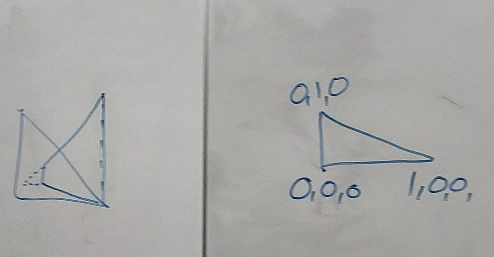
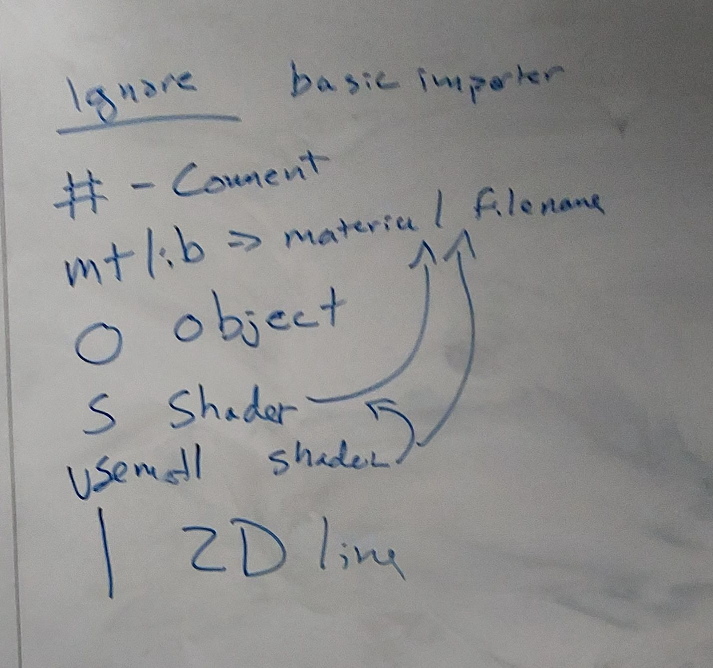
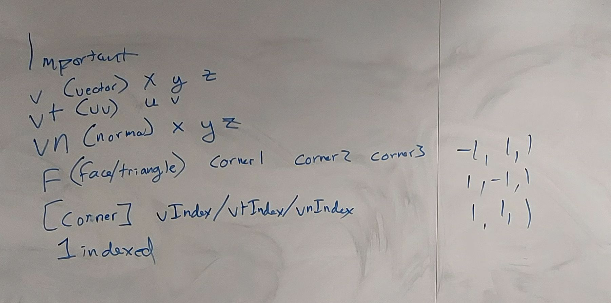
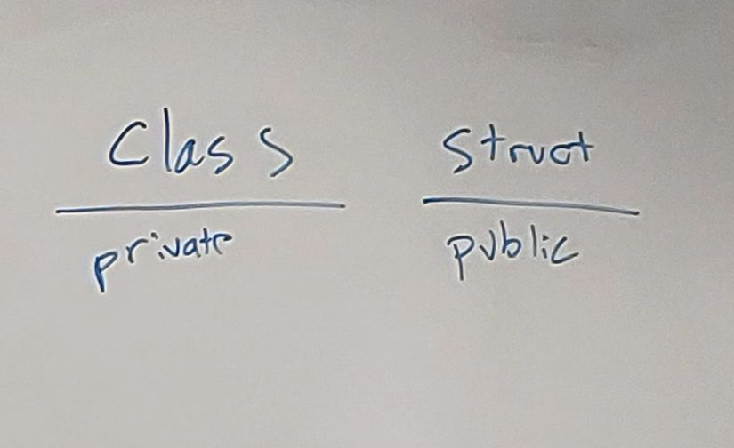

## 🏛️👩‍💻Module: [C++ Classes in Files](./modules/C++%20Classes%20in%20Files.md)

## Ray Tracing Multiple Triangles
- Store a list (vector) of triangles to render
- Track the closest `t` across all triangles.
  - We calculated `t` early when we are finding the plane the triangle lies in. If this `t` is further away than the closest `t`, we can immediately stop calculating that triangle
  - However, if the plane's `t` is closer than the closest `t`, don't update it under we are certain we are inside the triangle on that plane.
- Ignore negative `t`s

## 👩‍💻Code Together: Create Triangles and Meshes
- A mesh has an array of triangles and a shader
- A triangle has three Vector3s

## 🏛️👩‍💻Module: [OBJ Export and Import](./modules/OBJ%20Export%20and%20Import.md)

  
---
---

# October 20 - No Class, University Holiday
  
---
---

# Day 15 - October 15 - Ray Tracing: First Full Algorithm [Ray Tracing] (🧑‍🏫Lecture 10)

## 🏛️👩‍💻Module: [Ray Triangle Collisions](./modules/Ray%20Triangle%20Collisions.md)

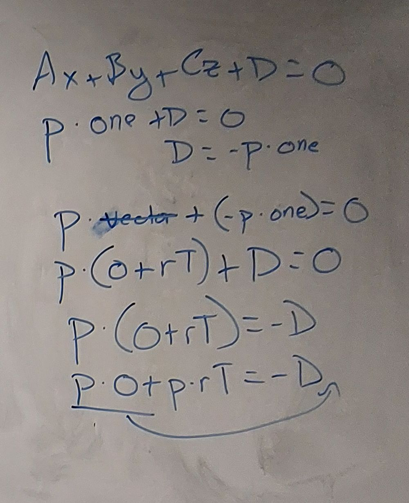
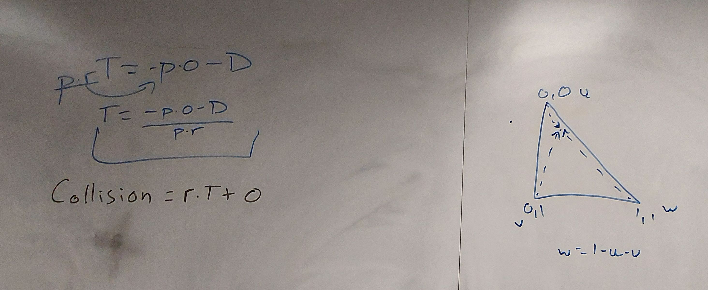

  
---
---

# Day 14 - October 13  (👟Sprint 5)

Review of modeling, animation, and rendering

# Intro to Ray Tracing Math

If there is an image that is $(w,h)$ in size, how do I know where in 3D to send a ray if I am ray tracing through pixel $(p_x, p_y)$? Assume the camera origin is at $(0, 0, -1)$ and the look at point is $(0, 0, 0)$. In this canonical view, the image we are rendering to lies in the $x,y$ plane. Note that for the image y is down and for our image plane y is up.

Steps:
- Convert the pixel to percentages
- Convert range from $[0,1]$ to $[-1,1]$ by multiplying by 2 and subtracting 1
- Flip the y coordinate by inverting $y$
- Set 0 to 0.

Once we have a destination target, we need a vector from the origin to that destination that is normalized (length 1).

Steps:
- Find the direction $destination - origin$.
- Find the length of that resulting vector
- Divide the $x$, $y$, and $z$ coordinates by that length.

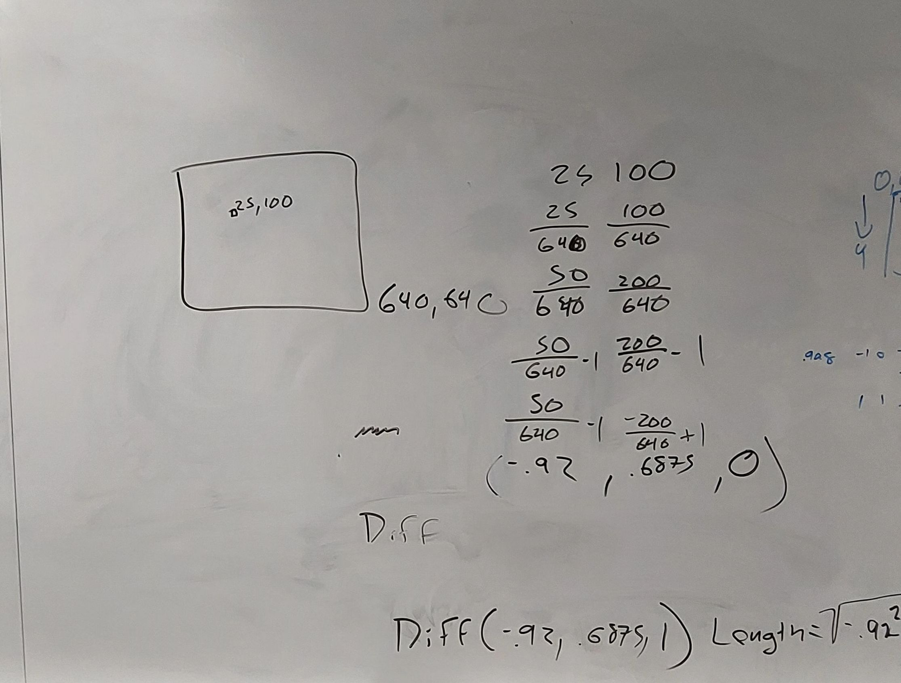
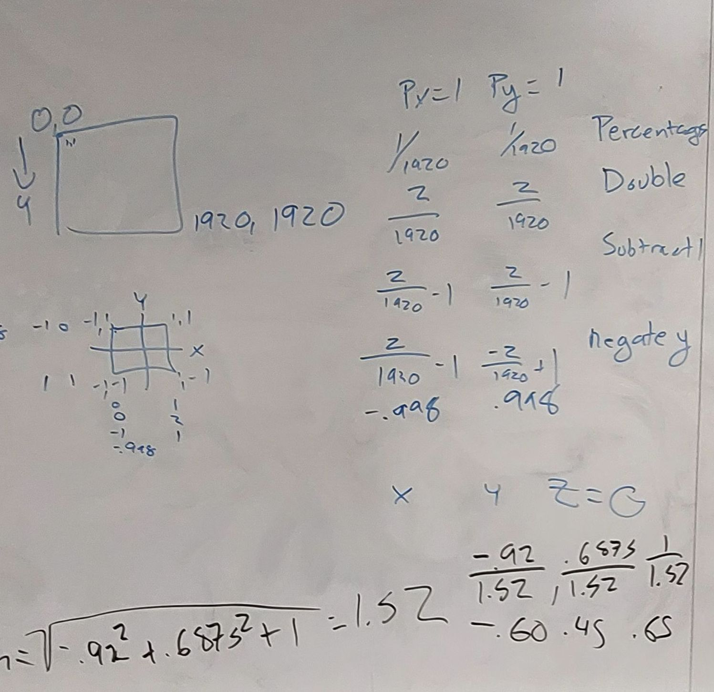
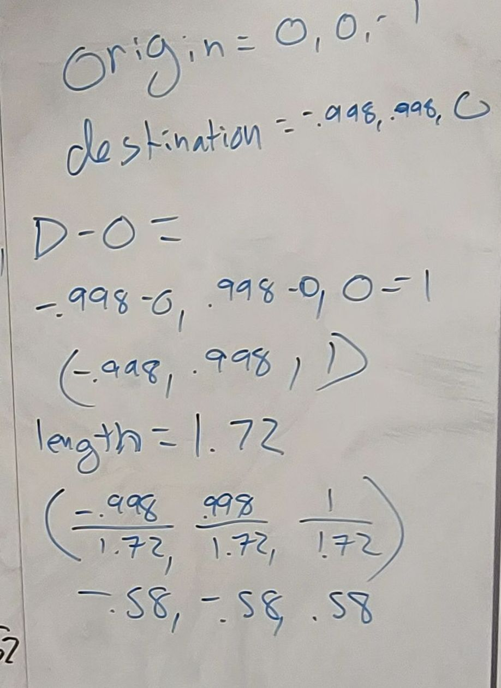
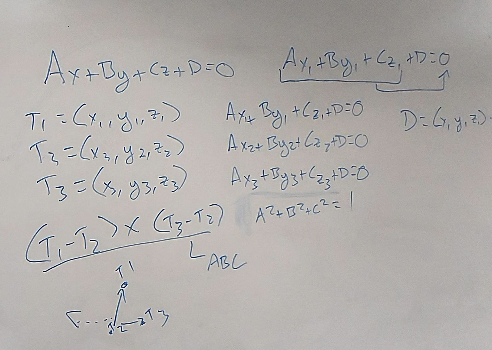

  
---
---

# Day 13 - October 08 - Ray Tracing: First Steps [Ray Tracing] (🧑‍🏫Lecture 9)

## 🏛️👩‍💻Module: [Introduction to C++](./modules/Introduction%20to%20C++.md)

## 🏛️👩‍💻Module: [Introduction to Coding Ray Tracers](./modules/Introduction%20to%20Coding%20a%20Ray%20Tracer.md)

  
---
---

# Day 12 - October 06  (👟Sprint 4)

Review of animation actions and boolean operators

  
---
---

# Day 11 - October 01 - Introduction to C++ [Ray Tracing] (🧑‍🏫Lecture 8)

## C++ Preparation
- Please review the [compiler setup](./C++%20Compiler%20Setup.md) page to make sure you can run C++ on any devices you own.
- Please review the [C++ Starting Examples](./C++Example.cpp) to make sure you understand the basics of the language.
- You are also free to use any of the many high-quality C++ tutorials available online.

  
---
---

# Day 10 - September 29  (👟Sprint 3)

  
---
---

# Day 09 - September 24 - Animation of Soft Bodies [Blender] (🧑‍🏫Lecture 7)
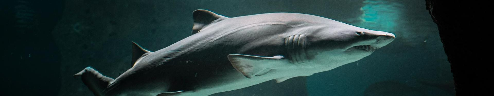

## 🏛️👩‍💻Module: [Rigging](./modules/Rigging.md)

## 🏛️👩‍💻Module: [Inverse Kinematics](./modules/Inverse%20Kinematics.md)

  
---
---

# Day 08 - September 22  (👟Sprint 2)

## 🏛️👩‍💻Module: [Normal Mapping](./modules/Normal%20Mapping.md)

  
---
---

# Day 07 - September 17 - Animation of Rigid Bodies [Blender] (🧑‍🏫Lecture 6)
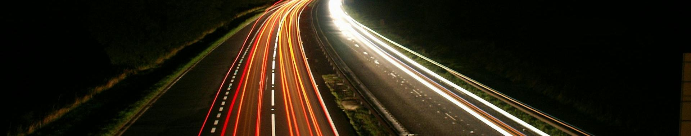

## 🏛️Module: [The Last Star Fighter](./modules/The%20Last%20Star%20Fighter.md)

## 🏛️Module: [Disney and Animation](./modules/Disney%20and%20Animation.md)

## 👩‍💻Module: [Rigid Body Animation - Basics](./modules/Rigid%20Body%20Animation%20-%20Basics.md)

## 👩‍💻Module: [Rigid Body Animation - Advanced](./modules/Rigid%20Body%20Animation%20-%20Advanced.md)

  
---
---

# Day 06 - September 15  (👟Sprint 1)

## 🏛️👩‍💻Module: [Open Shader Language](./modules/Open%20Shader%20Language.md)

  
---
---

# Day 05 - September 10 - Shading 2 [Blender] (🧑‍🏫Lecture 5)
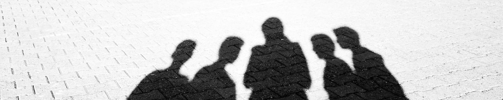

## 💡New Idea: Lighting is important to story telling
  - Look at different clips from videos. How is lighting use to tell a story or set a mood?

## 🏛️Module: [Ambient Lighting](./modules/Ambient%20Lighting.md)

## 🏛️Module: [Diffuse Lighting](./modules/Diffuse%20Lighting.md)

## 🏛️Module: [Blender Shading](./modules/Blender%20Shading.md)

## Normals on Objects
  - Different kinds of shading in Blender (smooth v flat)
  - Normals as an attribute of vertices gives us a way to hint at the curvature of a surface.

  
---
---

# Day 04 - September 03 - Shading 1 [Blender] (🧑‍🏫Lecture 4)

<!-- ## 🔙Review
- Consider vector A (1, 0, 0) and vector B(1, 1, 0)
- What is A cross B?
- What is A dot B?
- What is the length of A?
- What is the length of B? -->

## 🏛️Module: [Introduction to Texturing and UVs](./modules/Introduction%20to%20Texturing%20and%20UVs.md)

<!-- ## Different renderers
  
## Math Starter
- Normalize vectors
- Interpolate normals across a triangle

## Interpolate normal
Barycentric coordinates
- See calculator -->

## Actual texture maps
- Look at the texture map of a head online

## 🏛️Module: [Barycentric Coordinates](./modules/Barycentric%20Coordinates.md)

## Professional software
- Substance 3D
- Activity: Review Substance 3D demoreel/website https://www.youtube.com/watch?v=TzMHqw0Qp-s
- Activity: Look at texture painting in Blender, which is a simple version of Substance 3D

<!-- ## Normal maps -->

  
---
---

# Day 03 - September 01 - Rendering [Blender] (🧑‍🏫Lecture 3)
.jpg)

## 🏛️Module: [Disney History of Rendering](./modules/Disney%20History%20of%20Rendering.md)

## 🏛️Module: [History of PC Game Rendering](./modules/History%20of%20PC%20Game%20Rendering.md)

## 🏛️Module: [Introduction to Rasterizer Renderers](./modules/Introduction%20on%20Rasterizer%20Renderers.md)

## 🏛️Module: [Introduction to Ray Tracing Renderers](./modules/Introduction%20to%20Ray%20Tracing%20Renderers.md)

# 👩‍💻Activity: Rasterizing v Ray Tracing 
- Create a reflective surface is blender using a glossy material type
- The surface is not reflective with EEVEE but is reflective with Cycles

<!-- # 💡New Idea: EXR Images
- When we render, we can have Blender save more information than just the final image
- Among other things, it can save
  - Individual light groups
  - Normals
  - Depth
- When we want to save all this data, we use a special format called EXR

# 💡New Idea: Compositing
- Compositing is the stage of computer graphics after rendering and before the final product
- Compositing allows us to alter render results without having to re-render.
- The most popular compositing software right now is called [Nuke](https://www.foundry.com/products/nuke-family/nuke).

# 👩‍💻Activity: Compositing
- Save an EXR image
- In Blender's compositor, alter the impact of lights after a render. 

Watch this video and talk about how green screens are removed and images composited: 
https://www.youtube.com/watch?v=BdHCp62jC84
-->

  
---
---

# Day 02 - August 27 - Model Space [Blender] (🧑‍🏫Lecture 2)

## 📺 Video Overview
- You can see a video overview about [the basics on modeling, on YouTube](https://youtu.be/eEaA0L_JqOM)

## 🖼️Activity: Review the Syllabus 

## 🏛️Module: [Blender Model Space Editing](./modules/Blender%20Model%20Space%20Editing.md)

## 🏛️Module: [Cross Product](./modules/Cross%20Product.md)

# Day 01 - August 25 - World Space [Blender] (🧑‍🏫Lecture 1)

## 🏛️Module: [Introduction to Computer Graphics](./modules/Introduction%20to%20Computer%20Graphics.md)

## 🏛️👩‍💻Module: [Introduction to Blender](./modules/Introduction%20to%20Blender.md)

## 🏛️ Module: [Major Translations](./modules/Major%20Translations.md)

## 💡New Idea: Coordinate Systems
- Left-handed v right-handed coordinate systems
